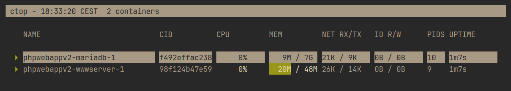
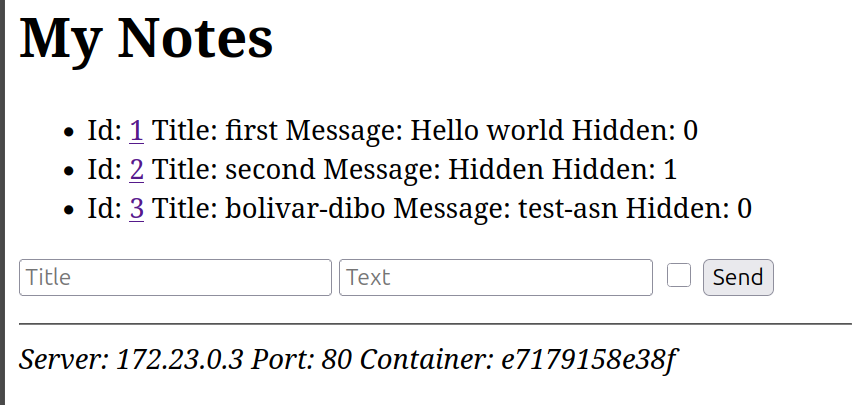
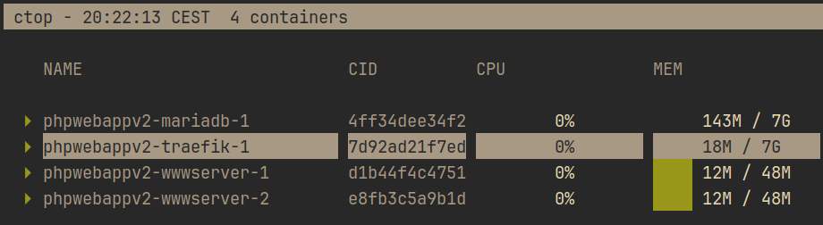

## Resumen

Se establece una app con load balacing mediante `traefik` y se gestionan los secretos que necesitan los contenedores.

## Paso 1: Inicialización de la app

El primer paso nos pide iniciar la aplicación y comprobar que responde, para esto ejecutamos `make` tal y como dice el `README.md`. Seguidamente los dos contenedores de la webapp y la base de datos se montan:



## Paso 2: Variables de entorno y secretos

En el segundo paso gestionamos las variables de entorno, el archivo `compose.yml` manda las variables directamente en el campo `environment`, por ejemplo:

<!-- keep -->
<!-- file: compose.yml -->
<!-- caption: secretos en texto plano en compose.yml -->
```yaml
mariadb:
    environment:
        - MYSQL_ROOT_PASSWORD=secret
        - MYSQL_DATABASE=notesdb
        - MYSQL_USER=usuario
        - MYSQL_PASSWORD=secreto
```

Ya que los credenciales están en texto claro en un archivo que se sube al repositorio, se migran estos valores a un archivo local secreto `.env`, y en `compose.yml` se sustituyen por la propiedad `env_file` que lee el archivo [1].

<!-- file: compose.yml -->
<!-- caption: compose.yml configurado para leer nuestro .env -->
```yaml
wwwserver:
    env_file: .env
...
mariadb:
    env_file: .env
```

Además modificamos `index.php` para que lea los secretos desde el archivo `.env` que le pasamos:

<!-- keep -->
<!-- file: html/index.php -->
<!-- caption: uso del vector $_ENV para leer las variables de .env -->
```php
$dbuser = $_ENV["MYSQL_USER"];
$dbpass = $_ENV["MYSQL_PASSWORD"];
```

Una vez cambiados los archivos ejecutamos `docker compose up -d` para recargar los contenedores y comprobamos que efectivamente PHP se conecta a MariaDB con los credenciales del entorno.



## Paso 3

El paso 3 nos pide establecer un loadbalancer en la app, tal y como hicimos en los pasos de prueba, para esto copiamos el directorio `traefik` al directorio de trabajo. En el archivo `dynamic-conf.yml` cambiamos los nombres de las replicas para reflajar la webapp [2]. Después actualizamos el `compose.yml` para agregar los contenedores necesarios:

<!-- file: compose.yml -->
<!-- caption: configuración para las replicas usando traefik -->
```yaml
wwwserver:
    scale: 2
    ports:
        - "80"
...
traefik:
    # idem a la configuracion de loadbalancer/
```

Una vez copiada la configuración ejecutamos `docker compose up -d` y obsevamos que se lanzan correctamente:



Si comprobamos nuestra app podemos ver como server y container cambian dinamicamente:

<!-- caption: input de la página mostrando el reparto de carga -->
```txt
Server: 172.23.0.4 Port: 80 Container: d1b44f4c4751
Server: 172.23.0.5 Port: 80 Container: e8fb3c5a9b1d 
```

## Declaración IA

Se ha usado Claude para guiar el proceso y explicar conceptos. Toda prosa ha sido escrita por los autores, y todo el setup ha sido ejecutado manualmente, salvo la generación del `.zip`.

## Referencias

[1] Docker Inc., "Docker Compose," *Docker Docs*. [En línea]. Disponible: <https://docs.docker.com/compose/>. [Accedido: 17-oct-2026].

[2] Traefik Labs, "Traefik Proxy Documentation," *Traefik Docs*. [En línea]. Disponible: <https://doc.traefik.io/traefik/>. [Accedido: 17-oct-2026].
