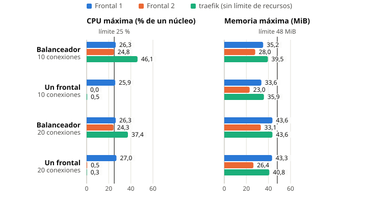

## Resumen

Partiendo del despliegue de la actividad 3.1, se configura `traefik` para descubrir sus nodos desde Docker, se ajusta Apache para que un frontal no agote su memoria y se mide con `ab` el comportamiento del sistema con y sin balanceador. Los experimentos se realizaron en un AMD Ryzen 7 5800X3D (8 núcleos, 16 hilos, 32 GB de RAM) con Docker Compose.

## Paso 1: Descubrimiento de nodos balanceados

En `traefik.yml` se comenta el proveedor `file` y se activa el proveedor `docker` con `exposedByDefault: false` [1], de modo que solo se balancean los contenedores con la etiqueta `traefik.enable=true`. Esa etiqueta se añade a `wwwserver` en el `compose.yml`, junto a la regla del router y el puerto interno del servicio. Ya no hace falta `dynamic-conf.yml` ni nombrar las réplicas a mano.

<!-- file: compose.yml -->
<!-- caption: etiquetas con las que traefik descubre las réplicas -->
```yaml
wwwserver:
    labels:
        - "traefik.enable=true"
        - "traefik.http.routers.wwwserver.rule=PathPrefix(`/`)"
        - traefik.http.services.wwwserver.loadbalancer.server.port=80
```

Con `docker compose up -d --scale wwwserver=5 --no-recreate` el panel pasa de 2 a 5 servidores `UP` sin reiniciar `traefik`. Al volver a `--scale wwwserver=2` los tres sobrantes desaparecen. En 8 peticiones a `http://localhost/` con 5 réplicas respondieron las cinco IP (2, 2, 1, 2 y 1 peticiones).


## Paso 2: Ajuste de recursos de los nodos

Cada frontal está limitado a `cpus: .25` y `mem_limit: 48m` sin swap, pero Apache en modo `prefork` admite por defecto `MaxRequestWorkers 150` [2], un proceso por petición. Lanzamos `ab -c 40 -t 20` directamente contra el puerto de un frontal con ese valor por defecto:

<!-- caption: ab con MaxRequestWorkers 150 (por defecto) -->
```txt
$ ab -c 40 -t 20 http://localhost:32768/
apr_socket_recv: Connection reset by peer (104)
Total of 3020 requests completed

$ docker inspect -f '{{.State.Status}} OOM={{.State.OOMKilled}} exit={{.State.ExitCode}}' phpwebappv2-wwwserver-1
exited OOM=true exit=137
```

`docker stats` mostró el contenedor en 47,08 MiB de 48 MiB con 42 procesos justo antes de caer, y `docker events` registró el evento `oom`: el kernel mató el contenedor por superar el límite de memoria [3], lo que equivale a la caída del servicio. Con 42 procesos ya llegaba al límite, así que se fija `MaxRequestWorkers` en 30 descomentando la línea del `Dockerfile` y se fuerza la reconstrucción de la imagen (`docker compose down` y `docker compose up -d --build`).

<!-- file: Dockerfile -->
<!-- caption: límite de procesos de Apache fijado al construir la imagen -->
```dockerfile
RUN sed -i 's/MaxRequestWorkers.*150/MaxRequestWorkers\t30/' \
    /etc/apache2/mods-available/mpm_prefork.conf
```

Repetida la misma prueba, el frontal no cae: 10 040 peticiones, 0 fallidas, 500,6 peticiones/s, tiempo total medio de 79 ms, mediana de 98 ms y máximo de 400 ms. El consumo máximo fue de 41,84 MiB con 31 procesos, por debajo del límite. Queda cerca de los 48 MiB, así que 30 no deja un margen holgado.


## Paso 3: Pruebas de estrés sobre el sistema balanceado

Con 2 réplicas, se lanzó cada experimento dos veces durante 20 s. En la figura 4.1 cada barra es la media de las dos ejecuciones y cada punto es una ejecución. La mediana fue de 1 ms con 10 conexiones y de 2 ms con 20 en todos los casos. En la figura 4.2 se muestra el mayor pico de las dos ejecuciones. Se usó `ab` 2.3 [4] desde la imagen oficial `httpd:2.4` con `--network host`, porque `apache2-utils` no estaba instalado. La herramienta compartió por tanto CPU y memoria con los contenedores, y los resultados son solo orientativos. En todos los casos hubo 0 peticiones erróneas y ningún contenedor fue detenido.




Observaciones:

- **El balanceador reparte la carga.** Con él trabajan los dos frontales, ambos al tope de su cuota de CPU (~25 %). Con acceso directo solo trabaja uno y el otro queda ocioso (0 % de CPU).
- **Más peticiones atendidas.** Con 10 conexiones, el balanceador atiende de 1,5 a 3,2 veces más peticiones que un único frontal (los 20 s de `-t` son iguales). Con 20 el margen baja a entre 1,2 y 1,8 veces, ya que cada frontal ya está saturado de CPU.
- **Estabilidad.** Ningún frontal superó su memoria. El máximo (43,6 MiB, con 26 procesos) queda por debajo de los 48 MiB.
- **Latencia en cola.** Con 20 conexiones, el máximo vía balanceador (2,6 a 4,1 s) es muy superior al directo (0,2 a 0,6 s), aunque la mediana es igual (2 ms). Esto no lo hemos verificado; sospechamos que se debe a la limitación de CPU de los frontales y a que `traefik` (sin límite) compite por CPU con `ab` en la misma máquina.
- **Variabilidad.** Las dos repeticiones difieren hasta un 60 %, por lo que no se pueden sacar conclusiones finas entre experimentos cercanos. Para resultados más objetivos habría que lanzar `ab` desde otra máquina de la misma subred.

## Declaración IA

Se ha usado Claude Code para montar el despliegue, diseñar los experimentos con `ab` y `docker stats`, recopilar los resultados y generar los gráficos.

## Referencias

[1] Traefik Labs, "Traefik Docker Provider," *Traefik Docs*. [En línea]. Disponible: <https://doc.traefik.io/traefik/providers/docker/>. [Accedido: 22-oct-2026].

[2] Apache Software Foundation, "Apache MPM prefork," *Apache HTTP Server 2.4 Docs*. [En línea]. Disponible: <https://httpd.apache.org/docs/2.4/mod/prefork.html>. [Accedido: 22-oct-2026].

[3] Docker Inc., "Resource constraints," *Docker Docs*. [En línea]. Disponible: <https://docs.docker.com/engine/containers/resource_constraints/>. [Accedido: 22-oct-2026].

[4] Apache Software Foundation, "ab - Apache HTTP server benchmarking tool," *Apache HTTP Server 2.4 Docs*. [En línea]. Disponible: <https://httpd.apache.org/docs/2.4/programs/ab.html>. [Accedido: 22-oct-2026].
