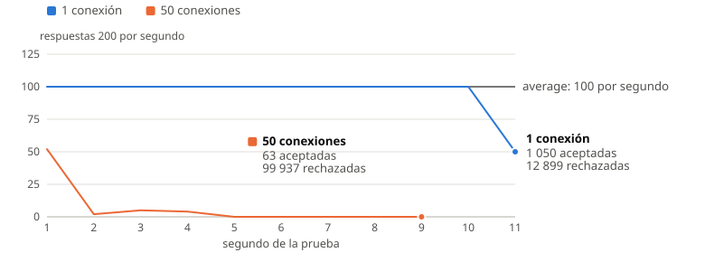
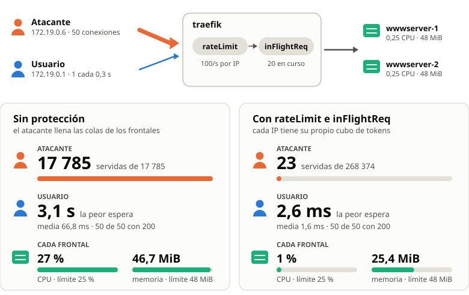

## Resumen

Sobre el despliegue de la actividad 3.2, se comprueba cómo reacciona `traefik` cuando un frontal se detiene o se pausa, y cómo protegerlo frente a picos de demanda. Con un *health check*, `traefik` saca un frontal pausado en 7 s; con un rate limit por IP, un atacante recibe `429` y un usuario con otra IP no lo nota. Cada prueba se ejecutó una vez, en un sistema con 8 núcleos y 32 GB de RAM.

## Paso 1: Recuperación frente a la caída de un nodo balanceado

Las observaciones usan un bucle de 4 peticiones al balanceador con `curl -s -m 10 localhost/`, que muestra el contenedor de cada respuesta. `curl` abandona una petición a los 10 s, de modo que un frontal que no responde aparece como `sin respuesta en 10 s`. El estado de cada nodo se lee en el dashboard de `traefik`.

### Parada de un frontal

Con los dos frontales activos, las respuestas alternan entre `wwwserver-1` y `wwwserver-2`. Tras `docker stop phpwebappv2-wwwserver-2`, las 4 respuestas llegan de `wwwserver-1`, sin ninguna petición perdida: `traefik` retira el contenedor parado en cuanto Docker lo notifica.

### Pausa de un frontal sin health check

`docker pause` congela el contenedor, que sigue en estado `running`, con su IP y su puerto, pero Apache no contesta. Para `traefik` nada ha cambiado: el panel sigue mostrando los dos servidores `UP` y le envía una de cada dos peticiones al frontal pausado. El bucle alterna una respuesta y un `sin respuesta en 10 s`, y el log de acceso muestra la causa:

<!-- caption: log de acceso de traefik con wwwserver-2 en pausa -->
```txt
"GET / HTTP/1.1" 200 622 ... "http://172.19.0.4:80" 1ms
"GET / HTTP/1.1" 499 21 ...  "http://172.19.0.3:80" 10001ms
```

El código `499` del log de acceso indica que el cliente cerró la conexión: `curl` abandonó a los 10 s mientras la petición seguía esperando al frontal pausado. Tras `docker unpause` las respuestas vuelven a alternar entre los dos frontales.

### Pausa de un frontal con health check

Para que `traefik` compruebe por sí mismo que cada frontal responde, se añade un *health check* al servicio con tres etiquetas en el `compose.yml` [1], todas con el prefijo `traefik.http.services.wwwserver.loadbalancer.healthcheck.`: `path=/` (la ruta que pide la comprobación), `interval=5s` (el tiempo entre comprobaciones, 30 s por defecto) y `timeout=5s` (la espera máxima antes de marcar el servidor como caído). Se aplican con `docker compose up -d wwwserver`.

Con `wwwserver-2` en pausa, `traefik` lo marcó `DOWN` a los 7 s ([[fig-2-1]]) y registró en su log `WRN Health check failed ... context deadline exceeded`. Desde ese momento el bucle no pierde ninguna petición: las 4 las atiende `wwwserver-1`. Tras `docker unpause`, la siguiente comprobación marcó el frontal `UP` a los 3 s, y las respuestas volvieron a alternar entre los dos.


## Paso 2: Protección frente a aumentos inesperados de la demanda

`traefik` ofrece dos tipos de protección. Los *middlewares* (filtros entre el router y el servicio) se declaran como etiquetas en el `compose.yml` y se aplican con `docker compose up -d wwwserver`. Los tiempos de las conexiones entrantes pertenecen al *entrypoint* `web` (el puerto 80), que es configuración estática: se escriben en `traefik.yml` y se aplican con `docker restart phpwebappv2-traefik-1`.

Las pruebas de carga lanzan `ab` desde la imagen `httpd:2.4`, con 50 conexiones durante 20 s o hasta 100 000 peticiones, mientras `docker stats` registra el consumo y el log de acceso el código de cada respuesta.

### Línea base sin protección

Sin middlewares, `ab -c 50 -t 20` completa 18 959 peticiones (948 por segundo), todas con `200`. Los dos frontales trabajan en el límite de su CPU (27 % de un núcleo con `cpus: .25`), con 30 procesos de Apache y hasta 46,6 MiB de sus 48 MiB. El resto de peticiones espera en cola, 53 ms de media.

### Middlewares de protección

La [[tab-3-1]] muestra las etiquetas de los dos middlewares, `wwwserver-inflight` y `wwwserver-ratelimit`. Cada etiqueta empieza por `traefik.http.middlewares.` y el nombre del middleware. Una petición rechazada por cualquiera de los dos recibe el código `429 Too Many Requests`.

<!-- caption: etiquetas de los middlewares de protección -->
| Etiqueta | Valor | Significado | Por defecto |
|---|---|---|---|
| `inflightreq.amount` | `20` | Peticiones en curso como máximo [2] | `0` |
| `ratelimit.average` | `100` | Peticiones de media por periodo y por IP [3] | `0` (sin límite) |
| `ratelimit.period` | `1s` | Periodo de la media | `1s` |
| `ratelimit.burst` | `50` | Peticiones que pasan de golpe | `1` |

La etiqueta `traefik.http.routers.wwwserver.middlewares=wwwserver-ratelimit,wwwserver-inflight` aplica los dos al router, en ese orden.

#### Máximo de peticiones en curso

`traefik` no tiene un límite de conexiones para cada servidor del servicio. El middleware `inFlightReq` cuenta las peticiones en curso de todo el router, de modo que con dos frontales y el reparto *round robin* el límite de 20 equivale a unas 10 por frontal. Por defecto agrupa las peticiones por la cabecera `Host` [2], así que todos los clientes de `localhost` comparten esas 20 plazas.

Con solo este middleware en el router, `ab -c 50` envía 100 000 peticiones en 8,1 s. `traefik` contesta 7 314 con `200` y 92 686 con `429`. Las 7 314 respuestas buenas son unas 900 por segundo, la misma capacidad de la línea base: los frontales siguen trabajando a su ritmo, y el exceso recibe un `429` inmediato. `docker stats` muestra que `wwwserver-2` baja a 20 procesos y 30,7 MiB, y que la CPU de `traefik` sube hasta el 304 %: rechazar 11 400 peticiones por segundo cuesta CPU en el balanceador. Con `ab -c 10`, por debajo del límite, las 9 694 peticiones reciben `200`.

#### Rate limit por IP

`rateLimit` usa un cubo de tokens (*token bucket*) para cada IP de origen [3]. El cubo guarda hasta `burst` tokens y se rellena a `average` tokens por `period`. Cada petición gasta un token, y una petición sin tokens recibe `429`. La [[fig-3-1]] muestra las respuestas aceptadas de cada segundo con una conexión (`ab -c 1 -t 10`) y con 50 (`ab -c 50`).



Con una conexión, en 10 s pasan 1 050 peticiones: las 50 de la ráfaga inicial y 100 por segundo. Con 50 conexiones (`ab -c 50`), en cambio, solo pasan 63 de 100 000: 52 en el primer segundo, entre 2 y 5 en los tres siguientes y ninguna después. La causa está en el código de `traefik` 3.7.16 [4]. Cada petición reserva un token, y si la espera supera 5 ms (la mitad del intervalo entre tokens), cancela la reserva y responde `429`. La cancelación solo devuelve el token si nadie reservó otro después. Con 50 peticiones simultáneas siempre hay reservas posteriores, de modo que los tokens no vuelven y el cubo queda vacío mientras dura el ataque.

Para los frontales el resultado es el deseado: su CPU baja del 27 % al 2 %.

### Tiempos de las conexiones entrantes

Los tiempos del entrypoint `web` limitan cuánto tiempo ocupa un cliente una conexión con `traefik`. `idleTimeout` cierra una conexión *keep-alive* sin peticiones, `readTimeout` corta una petición que no termina de llegar (un ataque *slowloris*) y `keepAliveMaxTime` responde `Connection: close` a una conexión activa demasiado larga.

<!-- file: phpwebappv2/traefik/traefik.yml -->
<!-- caption: tiempos del entrypoint web -->
```yaml
entrypoints:
  web:
    address: :80
    transport:
      keepAliveMaxTime: 10s
      respondingTimeouts:
        readTimeout: 10s
        idleTimeout: 5s
```

La [[tab-3-2]] muestra cuándo cierra `traefik` la conexión de `prueba-conexiones.py` en tres casos, con los valores por defecto y con esta configuración.

<!-- caption: cierre de una conexión entrante sin y con los tiempos del entrypoint -->
| Caso | Prueba | Por defecto | Con la configuración |
|---|---|---|---|
| `inactiva` | una petición y después silencio | cierre a los 180 s | cierre a los 5 s |
| `lenta` | una cabecera sin fin, un byte por segundo | corte a los 60 s | corte a los 10 s |
| `keepalive` | una petición por segundo en la misma conexión | 20 peticiones en 20 s sin corte | `Connection: close` a los 10 s |

### Prueba conjunta: un atacante y un usuario

La última prueba separa a un atacante de un usuario legítimo con dos IP distintas. El atacante lanza `ab -c 50 -t 20` desde un contenedor de la red `phpwebappv2_default` (IP `172.19.0.6`). A la vez, el usuario pide la página 50 veces desde el equipo (IP `172.19.0.1`), una cada 0,3 s. La [[fig-3-2]] compara la prueba sin middlewares y con los dos middlewares.

Sin protección, el atacante ocupa los 30 procesos de cada frontal y el usuario espera en la misma cola: una de sus peticiones tarda 3 s. Con protección, el rate limit agota el cubo del atacante y deja intacto el del usuario, porque cada IP tiene su propio cubo.

El orden de la cadena importa cuando los dos clientes usan el mismo `Host`: `inFlightReq` agrupa por esa cabecera, y sin el rate limit delante el atacante ocuparía las 20 plazas del usuario. Aquí el atacante pide `http://traefik/` y el usuario `localhost`, así que cada uno tiene sus 20 plazas.



## Declaración IA

Se ha usado Claude para generar los gráficos y figuras, guiar el proceso de testeo y ejecución y escribir un borrador inicial del documento. Toda la prosa ha sido revisada y actualizada por los autores.

## Referencias

[1] Traefik Labs, "HTTP Services: Load Balancing," *Traefik Docs*. [En línea]. Disponible: <https://doc.traefik.io/traefik/reference/routing-configuration/http/load-balancing/service/>. [Accedido: 27-oct-2026].

[2] Traefik Labs, "InFlightReq," *Traefik Docs*. [En línea]. Disponible: <https://doc.traefik.io/traefik/reference/routing-configuration/http/middlewares/inflightreq/>. [Accedido: 27-oct-2026].

[3] Traefik Labs, "RateLimit," *Traefik Docs*. [En línea]. Disponible: <https://doc.traefik.io/traefik/reference/routing-configuration/http/middlewares/ratelimit/>. [Accedido: 27-oct-2026].

[4] Traefik Labs, "rate_limiter.go," *traefik v3.7.16*, GitHub. [En línea]. Disponible: <https://github.com/traefik/traefik/blob/v3.7.16/pkg/middlewares/ratelimiter/rate_limiter.go>. [Accedido: 27-oct-2026].
