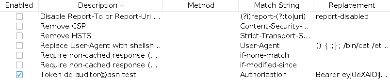
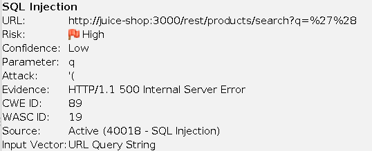
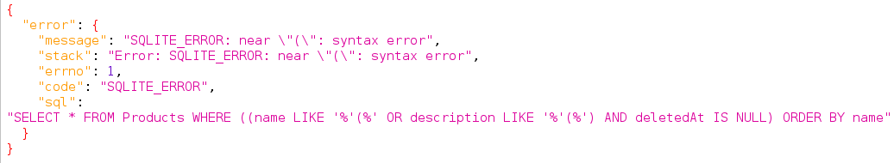

## Resumen ejecutivo

Auditoría dinámica de OWASP Juice Shop 20.4.0 con el escáner automático de ZAP 2.17.0 [1]. El riesgo global de la tienda es **alto**. El escaneo envió 18 952 peticiones y generó 592 alertas de 15 tipos. Tras la revisión manual, 4 tipos son problemas reales, 3 son ciertos pero sin impacto, 2 son falsos positivos y 6 son informativos. La prueba manual encontró 2 problemas más, que ZAP no informa.

El fallo más grave está en el buscador de productos: lo que escribe el usuario entra sin filtrar en una consulta a la base de datos. Un atacante podría usarlo para leer o cambiar los datos de los clientes, y un mensaje de error le enseña la consulta completa. El formulario de inicio de sesión responde con un error parecido, pero esta auditoría no lo confirma.

Hay otros problemas de menor riesgo:

- Una carpeta de ficheros internos abre sin iniciar sesión. Uno de los ficheros es una base de contraseñas cifrada.
- La sesión del usuario queda al alcance de cualquier script que corra en la página.
- La web no limita el código que ejecuta el navegador.
- La web entrega a cualquiera su configuración completa, y la página solo necesita una parte.
- Cualquier otra web puede leer los datos públicos de la tienda.

Las recomendaciones, por prioridad:

1. **Ahora:** parametrizar las consultas del buscador y del login [3], [4], y devolver un error genérico.
2. **Esta semana:** cerrar `/ftp` y servir solo los campos de la configuración que la web usa.
3. **Este mes:** añadir una política CSP, que limita el código del navegador [5]; guardar la sesión en una cookie `HttpOnly` [6]; y limitar CORS a los orígenes propios [7].

## Método

El entorno es local: Juice Shop [2] y ZAP corren en dos contenedores de Docker. Primero se explora la aplicación a mano con *Manual Explore*: registro de `auditor@asn.test`, inicio de sesión y una cesta con dos productos. Una regla de *Replacer* añade el token de ese usuario como cabecera `Authorization` a cada petición ([[fig-2-1]]). Así el escaneo alcanza las rutas que piden sesión, con el rol `customer`.

Después se lanza el *Automated Scan* con la política por defecto, el *spider* tradicional y el *Client Spider* con Firefox sin ventana. Cada alerta importante se repite a mano con `curl`. Las pruebas manuales solo leen: fuera del escaneo de ZAP, no se lanza ningún ataque. Las salidas están en `notas/pruebas-curl.txt`.

## Análisis técnico

### Alertas reales

La [[tab-3-1]] resume las alertas reales. ZAP detecta la inyección SQL en dos puntos, con confianza baja ([[fig-3-1]]). En el buscador, la respuesta al ataque `'(` confirma el fallo: el error de SQLite muestra la consulta, con el parámetro `q` copiado sin filtrar ([[fig-3-2]]). En el login, ZAP solo registró un `500`, sin el texto del error. El fallo del login es probable, pero esta auditoría no lo confirma a mano.

<!-- caption: alertas reales tras la revisión manual -->

| Alerta de ZAP (n.º) | Riesgo de ZAP | Riesgo revisado | Comprobación manual |
|---|---|---|---|
| SQL Injection (2) | Alto | Alto | El buscador devuelve `500` con `SQLITE_ERROR` y la consulta. El login devuelve `500` sin detalle |
| CSP Header Not Set (78) | Medio | Medio | `curl -I /` no devuelve `Content-Security-Policy` |
| JWT in Browser localStorage (1) | Medio | Medio | El token va en `localStorage`. Su payload incluye `role`, `email` y `password` (un MD5) |
| Cross-Domain Misconfiguration (136) | Medio | Bajo | `Access-Control-Allow-Origin: *` en la web y en la API, sin `Access-Control-Allow-Credentials` |

El riesgo de CORS baja a bajo. La respuesta no permite credenciales, y el token va en la cabecera `Authorization`, no en una cookie. Otra web no puede leer ese token, así que solo lee los datos que ya son públicos.

### Hallazgos manuales

La prueba manual encontró dos problemas que ZAP no informa ([[tab-3-2]]). Un escaneo automático no sustituye una prueba manual.

<!-- caption: hallazgos que ZAP no informa -->

| Hallazgo | Riesgo | Comprobación manual |
|---|---|---|
| Listado de `/ftp` | Medio | `GET /ftp/` lista 10 ficheros. `acquisitions.md` e `incident-support.kdbx` (KeePass) se descargan con `200`. Los `.bak` dan `403` |
| Configuración completa sin sesión | Bajo | `GET /rest/admin/application-configuration` da `200` sin token, con 7 bloques: `server`, `application`, `challenges`, `hackingInstructor`, `products`, `memories` y `ctf` |

La ruta de la configuración es pública por diseño. El código de la web la lee en 18 puntos, por ejemplo para el banner de bienvenida, que sale antes del login. Exigir el rol de administrador rompe la web. El problema es el exceso de datos: la respuesta lleva el correo de privacidad, las 13 redirecciones de OAuth, los 56 productos y las 9 entradas de `memories`.

### Alertas descartadas

La [[tab-3-3]] recoge el resto. Tres alertas son ciertas, pero no tienen impacto en esta aplicación.

<!-- caption: alertas sin impacto, falsos positivos e informativas -->

| Alerta de ZAP (n.º) | Veredicto | Motivo |
|---|---|---|
| Missing Anti-clickjacking Header (3) | Cierta, sin impacto | El `POST` a `/socket.io/` devuelve `text/html` sin `X-Frame-Options`, pero el cuerpo es solo `ok`. No hay una página que enmarcar |
| X-Content-Type-Options Header Missing (5) | Cierta, sin impacto | Las respuestas de `/socket.io/` no llevan `nosniff`, pero solo llevan paquetes de Engine.IO, sin datos del usuario |
| Private IP Disclosure (1) | Cierta, sin impacto | `192.168.99.100` es un valor por defecto de `googleOauth.authorizedRedirects`. El contenedor usa `172.17.0.2` |
| Timestamp Disclosure - Unix (4) | Falso positivo | `1969196030` y `1970691216` son identificadores de Steam, no fechas |
| Session ID in URL Rewrite (11) | Falso positivo | `sid` identifica la conexión de Engine.IO [8], no la sesión del usuario, que va en `Authorization` |
| 6 tipos informativos (351) | Informativo | No son vulnerabilidades. *User Agent Fuzzer* genera 276 |

### Correcciones

La [[tab-3-4]] da la corrección de cada hallazgo, con su CWE.

<!-- caption: corrección de cada hallazgo -->

| Hallazgo | CWE | Corrección |
|---|---|---|
| SQL Injection | 89 | Consultas parametrizadas en el buscador y en el login [4]. Un error genérico, sin la consulta ni la traza |
| Listado de `/ftp` | 548 | Quitar el listado, y sacar los ficheros internos del servidor web |
| Falta de CSP | 693 | `Content-Security-Policy` con `default-src 'self'`, y ampliar solo lo necesario [5] |
| JWT en `localStorage` | 922 | Una cookie `HttpOnly`, `Secure` y `SameSite` [6]. Quitar `password` del payload |
| CORS abierto | 942 | Una lista de los orígenes propios en lugar de `*` [7] |
| Configuración completa | 200 | Una ruta pública con solo los campos de la web, y el resto con el rol de administrador |
| Cabeceras de `/socket.io/` | 1021, 693 | Opcional: las mismas cabeceras que el resto de rutas |

## Declaración de uso de IA

Se ha usado Claude para guiar el proceso y estrucutrar el informe.

## Referencias

[1] ZAP, "ZAP Docs," *Checkmarx*. [En línea]. Disponible: <https://www.zaproxy.org/docs/>. [Accedido: 16-nov-2026].

[2] B. Kimminich, "OWASP Juice Shop," *OWASP*. [En línea]. Disponible: <https://owasp-juice.shop/>. [Accedido: 16-nov-2026].

[3] OWASP, "A05:2025 - Injection," *OWASP Top 10:2025*. [En línea]. Disponible: <https://owasp.org/Top10/2025/A05_2025-Injection/>. [Accedido: 16-nov-2026].

[4] OWASP, "SQL Injection Prevention Cheat Sheet," *OWASP Cheat Sheet Series*. [En línea]. Disponible: <https://cheatsheetseries.owasp.org/cheatsheets/SQL_Injection_Prevention_Cheat_Sheet.html>. [Accedido: 16-nov-2026].

[5] OWASP, "Content Security Policy Cheat Sheet," *OWASP Cheat Sheet Series*. [En línea]. Disponible: <https://cheatsheetseries.owasp.org/cheatsheets/Content_Security_Policy_Cheat_Sheet.html>. [Accedido: 16-nov-2026].

[6] OWASP, "HTML5 Security Cheat Sheet," *OWASP Cheat Sheet Series*. [En línea]. Disponible: <https://cheatsheetseries.owasp.org/cheatsheets/HTML5_Security_Cheat_Sheet.html>. [Accedido: 16-nov-2026].

[7] MDN, "Cross-Origin Resource Sharing (CORS)," *MDN Web Docs*. [En línea]. Disponible: <https://developer.mozilla.org/en-US/docs/Web/HTTP/Guides/CORS>. [Accedido: 16-nov-2026].

[8] Socket.IO, "The Engine.IO protocol," *Socket.IO Docs*. [En línea]. Disponible: <https://socket.io/docs/v4/engine-io-protocol/>. [Accedido: 16-nov-2026].
