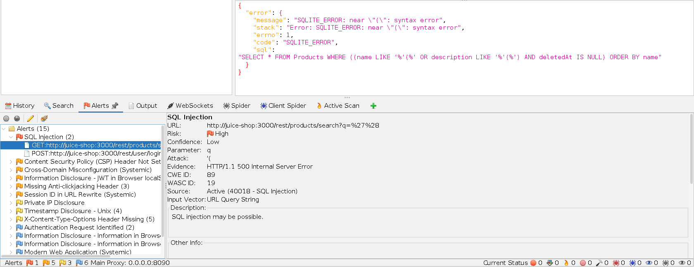

## Resumen

Auditoría dinámica de OWASP Juice Shop 20.4.0 con el escáner automático de ZAP 2.17.0 [1]. El escaneo envió 18 952 peticiones y generó 592 alertas de 15 tipos. Tras la revisión manual, 5 tipos son reales, 4 son falsos positivos y 6 son informativos. La vulnerabilidad crítica es una inyección SQL.

## Resumen ejecutivo

La tienda tiene un fallo grave: el buscador de productos y el formulario de inicio de sesión copian lo que escribe el usuario dentro de una consulta a la base de datos. Un atacante puede aprovecharlo para leer datos de clientes o alterarlos, y un mensaje de error le enseña la consulta completa. Hay otros cinco problemas: una página de administración y una carpeta de ficheros internos abren sin iniciar sesión, la sesión del usuario queda al alcance de un script malicioso, y la web no limita el código del navegador ni los orígenes que la consultan. Las recomendaciones, por prioridad:

1. **Ahora:** parametrizar las consultas del buscador y del login [3], [4], y devolver un error genérico.
2. **Esta semana:** exigir rol de administrador en `/rest/admin/application-configuration` y cerrar `/ftp`.
3. **Este mes:** añadir una política CSP [5], limitar CORS y quitar `password` del token.

## Método

El entorno es local: Juice Shop [2] y ZAP corren en dos contenedores de Docker. Primero se explora la aplicación a mano con *Manual Explore*: registro de `auditor@asn.test`, inicio de sesión y una cesta con dos productos. Una regla de *Replacer* añade su token como cabecera `Authorization` a cada petición, y así el escaneo alcanza las rutas con sesión. Después se lanza el *Automated Scan* con la política por defecto, el *spider* tradicional y el *Client Spider* con Firefox sin ventana. Cada alerta importante se repite a mano con `curl`. Las capturas son del escritorio real, sin el marco de la ventana.

## Análisis técnico

La [[tab-4-1]] resume las alertas reales. La inyección SQL es real en los dos puntos: el error del buscador muestra `SELECT * FROM Products WHERE ((name LIKE '%'(%' ...`, de modo que `q` entra sin filtrar en la consulta ([[fig-4-1]]). ZAP le da confianza baja, pero el error de SQLite lo confirma.

<!-- caption: alertas reales tras la revisión manual -->

| Alerta de ZAP | Riesgo | Comprobación manual |
|---|---|---|
| SQL Injection | Alto | `GET /rest/products/search?q=%27%28` y `POST /rest/user/login` devuelven `500` con `SQLITE_ERROR` |
| CSP Header Not Set (78) | Medio | `curl -I /` no devuelve `Content-Security-Policy` |
| Cross-Domain Misconfiguration (136) | Medio | `Access-Control-Allow-Origin: *` en la web y en la API |
| JWT in Browser localStorage | Medio | El payload del token incluye `role`, `email` y `password` (32 caracteres hexadecimales, un MD5) |
| Private IP Disclosure | Bajo | `/rest/admin/application-configuration` responde `200` sin token y lista `192.168.99.100` |

La última fila es más grave de lo que indica ZAP: `GET /api/Users` sin token da `401`, y la URL de configuración no. Es un fallo de control de acceso que ZAP solo señala por las IP. Además, `/ftp/` lista ficheros internos y deja descargar `acquisitions.md`, y ZAP no lo informa: un escaneo automático no sustituye una prueba manual. La [[tab-4-2]] recoge lo descartado.

<!-- caption: alertas descartadas o informativas -->

| Alerta de ZAP | Veredicto | Motivo |
|---|---|---|
| Timestamp Disclosure - Unix (4) | Falso positivo | `1969196030` y `1970691216` son identificadores de Steam, no fechas |
| Missing Anti-clickjacking Header (3) | Falso positivo | Son respuestas de `/socket.io/`, sin HTML. La web sí envía `X-Frame-Options` |
| X-Content-Type-Options Missing (5) | Falso positivo | Son respuestas JSON de `/socket.io/`. La web y la API sí envían `nosniff` |
| Session ID in URL Rewrite (11) | Falso positivo | `sid` identifica el transporte de `socket.io`. La sesión va en la cabecera `Authorization` |
| Seis alertas informativas (351) | Informativo | No son vulnerabilidades. *User Agent Fuzzer* genera 276 |

## Declaración de uso de IA

Se ha usado Claude para guiar el proceso y estrucutrar el informe.

## Referencias

[1] ZAP, "ZAP Docs," *Checkmarx*. [En línea]. Disponible: <https://www.zaproxy.org/docs/>. [Accedido: 16-nov-2026].

[2] B. Kimminich, "OWASP Juice Shop," *OWASP*. [En línea]. Disponible: <https://owasp-juice.shop/>. [Accedido: 16-nov-2026].

[3] OWASP, "A03:2021 - Injection," *OWASP Top 10:2021*. [En línea]. Disponible: <https://owasp.org/Top10/A03_2021-Injection/>. [Accedido: 16-nov-2026].

[4] OWASP, "SQL Injection Prevention Cheat Sheet," *OWASP Cheat Sheet Series*. [En línea]. Disponible: <https://cheatsheetseries.owasp.org/cheatsheets/SQL_Injection_Prevention_Cheat_Sheet.html>. [Accedido: 16-nov-2026].

[5] OWASP, "Content Security Policy Cheat Sheet," *OWASP Cheat Sheet Series*. [En línea]. Disponible: <https://cheatsheetseries.owasp.org/cheatsheets/Content_Security_Policy_Cheat_Sheet.html>. [Accedido: 16-nov-2026].
